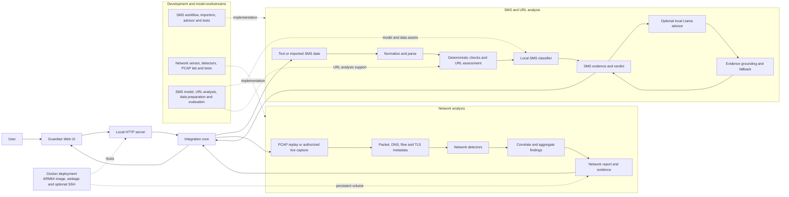

# Guardian — Offline-first Arm Linux Security Demonstrator

Guardian is an offline-first security demonstrator for Arm Linux. It brings together two analysis workflows—SMS/smishing analysis and network anomaly analysis—behind a local web interface and command-line tools.

**Deterministic detectors own the security verdicts.** The optional local Llama advisor is used to explain evidence; it does not make or alter verdicts. Any approved playbook actions are presented separately from generated advisor text.

## Architecture



## Features

- **SMS / smishing analysis:** Analyze SMS text and supported imports using deterministic checks and the local classifier.
- **URL assessment:** Examine URLs and associated indicators as part of the SMS workflow.
- **Optional local advisor:** Generate evidence-grounded explanations locally; fallback behavior is used when advisor output cannot be grounded.
- **Network analysis:** Replay PCAPs by default; authorized live capture is also supported when the environment and privileges permit.
- **Network detectors:** Analyze DNS, flows and TLS metadata for configured anomaly patterns.
- **Local web interface and CLI:** Use the integrated workflows through the web UI or command-line entry points.
- **Offline-first operation:** Analysis and model assets are intended to be local; no cloud service is required for the core demonstrator workflows.

## Repository layout

```text
.
├── person-a/       # SMS workflow, imports, advisor, tests and evaluation
├── person-b/       # Network sensor, detectors, PCAP lab and tests
├── person-c/       # SMS model, training, URL analysis, data and evaluation
├── guardian_web/   # Web UI, integration core, HTTP server and CLI
├── deploy/         # ARM64 Docker deployment and optional SSH configuration
└── docs/           # Architecture and project documentation
```

## Run tests

From the repository root:

```bash
python3 -m unittest discover -s person-a/tests -v
python3 -m unittest discover -s person-b/tests -v
python3 -m unittest discover -s person-c/tests -v
```

## Dataset integration and benchmark results

Dataset roles, provenance requirements, evaluation gates and benchmark adapters are tracked in:

- [Dataset integration plan](docs/DATASET_INTEGRATION_PLAN.md)
- [Dataset registry](docs/dataset_registry.json)

The SMS pipeline trains from the public SMS/phishing corpus plus the reviewed multilingual starter set when the local model artifact is first created. Indian hard negatives remain evaluation-only.

Reported results are **benchmark or lookup-integrity results, not universal live-network accuracy claims**:

- SMS hard-scam recall improved from 60.0% to 86.7% with multilingual augmentation.
- UNSW-NB15 reached 84.68% attack recall on its held-out partition.
- CICIDS2017 reference benchmarks reached 99.92% DDoS recall and 99.90% PortScan recall.
- A signed OpenPhish bundle matched 300/300 feed URLs with 0/20 curated benign matches.

The DNS reference model and threat bundle are opt-in. Use `--dns-model` and `--threat-bundle` with the network CLI; deterministic rules remain the default safety layer. Raw external datasets remain gitignored. Check dataset and source licences before redistribution.

## Docker deployment (ARM64)

Guardian can be deployed using the Docker configuration under `deploy/`.

### Requirements

- Docker with Docker Compose support
- ARM64 Linux environment or ARM64 Docker environment
- Sufficient disk space for the image and local model assets

### Install

```bash
git clone <repository-url>
cd ARM-Hackathon
./deploy/setup.sh
```

The setup script prompts for deployment settings, builds the ARM64 image and starts the container. The webapp port defaults to `8080`; optional SSH access uses a host port defaulting to `2222` and a locally configured password.

### Access

- Web interface: `http://localhost:8080` (or the configured webapp port)
- Optional SSH: `ssh -p 2222 guardian@localhost` (or the configured SSH port)

### Manage the deployment

Run Docker Compose commands from `deploy/`.

```bash
cd deploy

# Stop and remove the container (persistent reports volume remains)
docker compose down

# Start
docker compose up -d

# Restart
docker compose restart

# Logs
docker compose logs -f

# Status
docker compose ps

# Rebuild and start
docker compose up -d --build
```

If optional SSH is enabled through the SSH Compose override, use the same override configuration when managing that deployment.

### Persistence

Network reports are stored in the persistent Docker volume `guardian_reports`. Removing or recreating the container does not delete this volume.

To delete the container **and** the stored reports:

```bash
cd deploy
docker compose down -v
```

This removes the persistent volume and its data.

### Security notes

- The webapp and SSH ports bind to `127.0.0.1` by default.
- SSH is restricted to the `guardian` user inside the container.
- SSH credentials and deployment settings are stored locally and excluded from Git.
- The webapp currently has **no authentication**. Do not expose it to public or untrusted networks without implementing and reviewing appropriate access controls.
- Live capture requires appropriate privileges and should only be performed on networks you are authorized to monitor.

### Troubleshooting

**Docker unavailable:** Ensure Docker is installed and running.

**Webapp inaccessible:** From `deploy/`, check `docker compose ps` and `docker compose logs`; confirm the selected host port.

**SSH connection fails:** Check container status and logs, and confirm the configured SSH port and that SSH was enabled for the deployment.

**Port conflict:** Rerun the setup script and choose an available host port.

## Additional project documentation and test artifacts

After completing the Docker setup, consult the component-specific READMEs for details on each workstream:

- `person-a/README.md` — SMS workflow, imports, advisor, tests and related evaluation details.
- `person-b/README.md` — network analysis workflow, sensor, detectors and supporting test/PCAP setup.
- `person-c/README.md` — SMS model, URL analysis, training and evaluation workflow.
- `person-c/data/README.md` — SMS/model data files, their roles and handling notes.
- `person-c/evaluation/README.md` — evaluation procedures, outputs and evidence artifacts.
- `guardian_web/README.md` — integrated web interface, core, server and CLI details.

### `docs/`

The `docs/` directory contains project documentation and reference material:

- `dataset_registry.json` — dataset metadata and registry information.
- `guardian-architecture.mmd` — Mermaid source for the Guardian architecture diagram.

### `integration-tests/`

The `integration-tests/` directory contains cross-workstream integration checks, offline/smoke and verifier reliability tests, and saved benchmark or regression evidence. These artifacts help validate integrated behavior and preserve reproducibility evidence; they are not all necessarily invoked by the ordinary component unit-test commands above.


---

Guardian is an offline-first Linux security demonstrator. The deployment provides a local interface and optional SSH access while keeping the core analysis workflows local.
