# Guardian Architecture

## Scope

Guardian is an offline-first SMS security assistant for an ARM Linux target. Person C owns the SMS/URL models, data pipeline, evidence contract and Llama explanation interface. The primary Phase 1 scenario is smishing: a message attempts to create urgency, impersonate a trusted service, obtain credentials, request payment, or direct the user to a suspicious URL.

## End-to-end flow

```mermaid
flowchart LR
    Input[SMS input] --> Norm[Normalize text and URLs]
    Norm --> Lang[Language and script routing]
    Lang --> Detect[Fast detector\nrules plus compact linear model]
    Detect --> Evidence[Structured evidence\nscore, tier, signals, provenance]
    Evidence --> Decision[Calibrated decision\nALERT / REVIEW / BENIGN_CANDIDATE]
    Decision --> Explain[Deterministic explanation]
    Evidence -. structured evidence only .-> Llama[Llama-family model\nExecuTorch on device]
    Llama --> Verify[Output verifier]
    Verify --> Explain
    Explain --> User[Safe recommendation]
    Public[Public and consented data] --> Split[Campaign/time split]
    Split --> Train[Train and evaluate]
    Train --> Artifact[Versioned artifact]
    Artifact -. offline import .-> Detect
```



The editable diagram is [docs/guardian-architecture.mmd](docs/guardian-architecture.mmd).

## Detection boundary

The detector is the security authority. It normalizes input, extracts URLs, evaluates deterministic signals, and optionally adds a compact model score. It emits evidence such as urgency, credential request, payment language, impersonation, suspicious link, or numeric sender context.

The Llama-family model is advisory. It receives structured evidence rather than raw SMS by default and may produce a concise explanation in the selected language. It must not change the detector score or downgrade a warning. A timeout, invalid output, or verifier failure falls back to the deterministic explanation.

## Runtime states

| State | Meaning | User-facing behavior |
|---|---|---|
| `ALERT` | Score is above the calibrated threshold | Show warning and safe action |
| `REVIEW` | Score is within the review band | Ask the user to verify independently |
| `BENIGN_CANDIDATE` | No strong signal was found | Avoid claiming the message is safe |

Input is bounded to the artifact’s configured maximum length. No URL is opened, no DNS lookup is required for SMS detection, and no message is sent to a remote service.

## Multilingual path

Language routing is a lightweight offline heuristic. URLs are excluded from language selection. Hindi Devanagari text is labelled `hi`; Roman Hindi markers are labelled `hinglish`; mixed Hindi/English text is labelled `hi-en`. These labels select presentation and evidence vocabulary; they are not a claim of linguistic certainty.

The public multilingual corpus provides English and machine-translated Hindi. Hinglish remains a separate synthetic or consented data track until a suitable public source is verified.

## Evidence contract

Each detector result contains:

```text
evidence_id, source, event_type, timestamp, entity,
risk_tier, score, reasons, related_ids
```

SMS-specific fields include language metadata, matched signals, deterministic safe action, extracted URLs and a human-readable explanation. IDs are stable hashes of source and entity values; raw message text is not stored in the evidence record.

## Data and model lifecycle

1. Collect only public, licensed, consented, or synthetic data.
2. Redact phone numbers and email addresses before storage.
3. Assign campaign/template groups before splitting.
4. Keep campaign groups disjoint across train, calibration and test sets.
5. Calibrate the operating threshold on validation data, never on the test set.
6. Record dataset source, label balance, split, model format, runtime configuration and target-device measurements in the artifact/report.
7. Import the artifact offline and verify its format before activation.

The Playwright scraper writes `public_sms.jsonl`, `public_sms_multilingual.jsonl`, and their provenance files. The multilingual source is machine-translated and heavily imbalanced, so it is suitable for robustness checks rather than standalone production evaluation.

## Device boundary

The planned Android deployment separates responsibilities:

- **Core** receives SMS, runs local models, stores minimal evidence, fuses findings and displays alerts. It should not request `INTERNET`.
- **Net** owns `VpnService` and emits only authorised DNS/flow metadata. It must not access SMS content or run the Core models.
- **ExecuTorch runtime** executes the required Llama-family model locally on the selected ARM target.

The separation is a permission and data-flow boundary, not only a package layout. Network failure must not disable local SMS detection.

## Current implementation status

Implemented: SMS and URL baselines, multilingual routing, Hindi/Hinglish indicators, evidence output, model-feature explanations, campaign-safe training, calibration, public Playwright collection, source metadata and unit tests.

Pending for the final device demonstration: ExecuTorch model export and measured Llama inference, Android/Core integration, target-device RAM and thermal measurements, time-ordered or independently collected evaluation, and authorised offline lab validation.
