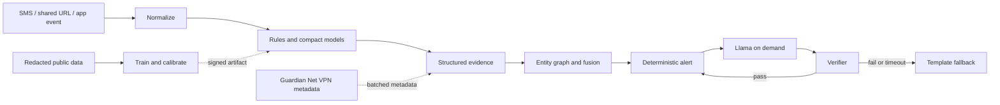

# Guardian Architecture

## Product purpose

Guardian is an offline-first Android security assistant for a smishing kill chain:

`SMS lure -> suspicious URL -> DNS or network behaviour -> optional app-risk signal`

The system combines SMS, URL, app and network evidence into one incident timeline and explains the result in plain language.

## Architecture diagram

The editable full diagram is in [docs/guardian-architecture.mmd](docs/guardian-architecture.mmd).

## Security boundary

Guardian uses two Android application components:

- **Core**: receives SMS, checks URLs, evaluates app metadata, stores evidence, fuses findings and displays alerts. Core must not request `INTERNET`.
- **Net**: owns `VpnService`, forwards traffic and emits DNS/flow metadata. Net must not access SMS content, run the Core models or store message content.

This is a privacy boundary enforced by Android permissions, not only a code-organization choice.

## Evidence flow

1. Collect SMS, URLs, app metadata and network summaries.
2. Normalize text and URLs, including Unicode confusables and canonical domains.
3. Run deterministic rules and compact models before any language-model inference.
4. Emit structured evidence with an ID, source, event type, timestamp, entity, score, tier and reasons.
5. Deduplicate and correlate evidence by entity and time window.
6. Assign the security tier using detector evidence and a documented fusion table.
7. Show a deterministic explanation immediately.
8. Optionally use local Llama only to paraphrase the already-decided evidence.

The runtime uses a calibrated threshold and three states: `ALERT` for a clear detector result, `REVIEW` for an uncertain result that needs cautious wording, and `BENIGN_CANDIDATE` for a low-scoring result. `BENIGN_CANDIDATE` is not a claim that the message is safe.

## Person C service

The `person-c` directory contains the Models and Llama workstream:

- deterministic SMS and URL baselines;
- shared evidence-record contract;
- normalization utilities;
- tests and command-line smoke checks;
- campaign-safe training and evaluation;
- calibrated runtime artifacts with threshold and latency configuration;
- the future home for ExecuTorch exports and the Llama verifier.

Person C supplies model artifacts and interfaces to Core. Person C does not own the final security verdict: detectors and Core fusion do.

## Llama safety contract

Llama receives compact structured evidence rather than raw SMS by default. Its output must be checked for invented entities, unsupported reassurance, unauthorized actions, excessive length and contradictions. If loading, generation or verification fails, Core keeps the deterministic explanation.

## Network rollout

- **N0**: Core-only operation.
- **N1**: DNS sentinel and forwarding.
- **N2**: UDP/QUIC pass-through.
- **N3**: TCP relay and available TLS metadata.
- **N4**: optional IPv6, LAN inclusion and additional QUIC parsing.

Every stage must pass reliability tests before the next stage is enabled. VPN failure is fail-open: normal connectivity returns and Core continues SMS and URL protection.

## Current status

The repository now includes a Playwright-collected, redacted public corpus, campaign/template-aware splitting, calibrated SMS inference and real-time safety states. The public-corpus results are smoke benchmarks. Accuracy under distribution shift, false-positive behaviour on local legitimate messages, phone latency/memory, Android permission behaviour, ExecuTorch compatibility and the full kill-chain demo still require validation on the target device.
